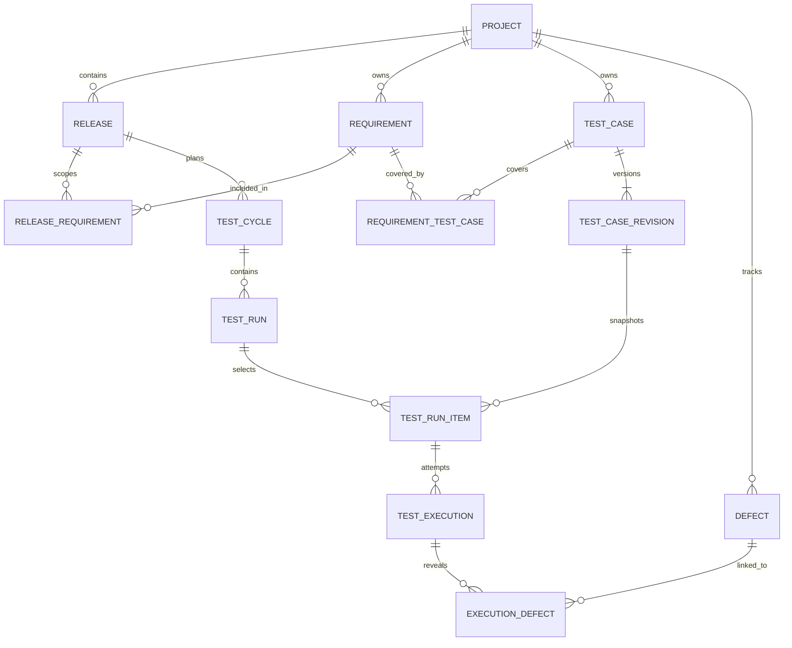

# Phase 2 and Feature 1: compatible QA architecture and release design

This is a design and implementation specification, not an applied migration. Security findings are reported first in `00-security-audit.md`; existing behavior is mapped in `01-current-system-inventory.md`. No feature code or database changes have been made.

## Architectural direction

Keep Next.js, NextAuth, NestJS, PostgreSQL, existing project/user identities, and current UI components. NestJS should own authorization, domain rules, SQL transactions, and authoritative audit events. Next server actions should validate inputs, obtain the session, call Nest, and revalidate appropriate views. Migrate direct frontend DB access to Nest incrementally; do not introduce a new ORM solely for releases.

The target traceability flow is supported by explicit relationships rather than a destructive single-parent tree:

Requirements and cases belong to a project and can be reused across releases. A case can cover multiple requirements and a requirement can have multiple cases. Release scope and run selection determine which revisions are tested for a version. Do not make a case belong exclusively to one release; otherwise reuse becomes duplication.

## Definition versus execution

| Record | Responsibility | Important fields/invariants |
| --- | --- | --- |
| TestCase | Stable identity for WHAT is tested | Preserve numeric id, projectId and external testId; current revision pointer, definition lifecycle such as draft/ready/archived, creator/updater. No mutable execution status/result as its source of truth. |
| TestCaseRevision | Immutable definition at a point in time | Case ID, revision number, scenario/title, module/page, preconditions, ordered steps, expected result, priority; revision author/time. Preserve a snapshot when a definition changes. |
| Requirement | Project-owned specification | Project ID, stable key, title/body, lifecycle, author/time. Link to releases and case revisions or explicitly versioned coverage. |
| TestCycle | Testing phase within release | Release ID, name, purpose, dates, lifecycle. Examples: regression or UAT. |
| TestRun | Concrete planned set/environment/build | Cycle/release context, environment, build, owner, lifecycle and timestamps. |
| TestRunItem | Selected revision and assignment | Run ID, revision ID, assigned tester, execution readiness; enforce same project throughout. |
| TestExecution | One historical attempt | Run item/revision, actor, attempt number, result, actual result, notes, started/finished/executedAt, environment/build snapshot. Re-test creates another attempt. |
| Defect | Independent issue lifecycle | Project ID, stable BUG key, summary/description, severity, priority, status, reporter/assignee, found/fixed release links, timestamps. Many execution links permitted. |

Execution statuses should be a separate validated enum: `pending`, `in_progress`, `passed`, `failed`, `blocked`, `skipped`. A pending run item is a planned item, not proof an execution happened; decide whether pending appears only on run items before implementing execution APIs. New execution outcomes never overwrite previous attempts. Definition edits create revisions. Corrections to finalized results should use auditable superseding records, with reason/actor, rather than silent updates.

Keep an execution history page and define latest-result views explicitly: latest attempt per run item for run metrics; latest relevant attempt per selected case for a release's current outcome. Report all attempts separately as activity. Pass rate must show its denominator: recommended completed-outcome pass rate is passed/(passed+failed), with blocked/skipped/pending displayed separately. Preserve existing passed/all-case metrics under a clearly labeled legacy summary until consumers migrate.

Example: the same stable TC-001 revision can yield four execution records scoped to releases 1.0 PASS, 1.1 PASS, 1.2 FAIL, and 1.2 Hotfix PASS. The failed attempt and linked defect remain available after the hotfix passes. If the test definition changes, later runs select a new revision without changing prior snapshots.

## Releases: final proposed schema

Use a new `releases` PostgreSQL table, with SERIAL identity and quoted camelCase foreign-key/timestamp fields to match the current schema. Suggested PostgreSQL types and rules:

| Field | Type/default | Rules |
| --- | --- | --- |
| id | SERIAL PRIMARY KEY | Existing numeric ID convention |
| projectId | INTEGER NOT NULL | FK projects(id), ON DELETE RESTRICT; project cannot change after creation |
| name | VARCHAR(200) NOT NULL | Trimmed, 2–200 characters; bilingual text accepted |
| version | VARCHAR(100) NOT NULL | Trimmed, 1–100 characters; human versions such as `1.2 Hotfix` supported; do not force SemVer |
| description | TEXT NULL | DTO bounded, proposed 10,000 characters |
| startDate | DATE NULL | Strict valid calendar date, ISO `YYYY-MM-DD` |
| releaseDate | DATE NULL | Planned/target date; must be >= startDate when both set |
| status | TEXT NOT NULL DEFAULT 'planning' | DB CHECK and DTO enum: planning, active, testing, released, archived |
| createdById | INTEGER NULL | FK users(id), ON DELETE SET NULL; derive actor server-side |
| updatedById | INTEGER NULL | Same rule; audit identity snapshots preserve attribution |
| createdAt | TIMESTAMPTZ NOT NULL DEFAULT NOW() | Server-generated |
| updatedAt | TIMESTAMPTZ NOT NULL DEFAULT NOW() | Set server-side on change; concurrency token |

Use a unique expression index on `(projectId, lower(btrim(version)))`; index `(projectId, status, createdAt DESC, id DESC)` for scoped lists. Add CHECKs for trimmed nonempty name/version and date ordering. `projectId` and audit fields are not writable on PATCH. Optional dates can be cleared explicitly with `null`; omitted means unchanged. UI labels are Planning, Active, Testing, Released, Archived, localized through existing language patterns; wire values stay lowercase like existing backend enums.

`releaseDate` remains the planned date; add `releasedAt TIMESTAMPTZ NULL` when actual release tracking is required instead of overloading that date. No release metrics are initialized to fictional values. Historical releases may be entered without dates; do not invent dates for legacy data. Multiple active releases per project are allowed for hotfix/parallel work.

Proposed transition policy: planning -> active or archived; active -> planning, testing or archived; testing -> active, released or archived; released -> archived; archived is read-only. A released release keeps metadata/history and allows no new execution writes; a hotfix is another release. Validate against the stored current state in a transaction and reject stale updates. Administrative reopen, if later needed, should be an explicit audited operation rather than arbitrary status PATCH.

There is no hard-delete release API initially. Archive is the default removal action. Existing project deletion must reject projects containing releases with a clear conflict message; do not cascade away QA history. This is an intentional extension of existing deletion safeguards.

## API and permission contract

Add `ReleasesModule`, controller/service and create/update/list DTOs under `backend/src/releases`, using `DatabaseService` and existing global JWT. Introduce a shared project-access service used by releases and then adopted by existing resources.

| Endpoint | Contract |
| --- | --- |
| `GET /api/projects/:projectId/releases` | Authorized project readers; query page >=1, limit 1–100 (default 20), optional search/status; deterministic createdAt/id ordering; existing `{data,meta}` pagination format |
| `POST /api/projects/:projectId/releases` | Admin only initially; 201; validates project exists and is active, body/date/status and uniqueness; actor from JWT |
| `GET /api/projects/:projectId/releases/:releaseId` | Admin or assigned member; enforce release belongs to path project |
| `PATCH /api/projects/:projectId/releases/:releaseId` | Admin only initially; enforce ownership, lifecycle, version/date constraints and expected updatedAt concurrency token |

Use 401 unauthenticated, 403 outside project policy, 404 nonexistent resource under an authorized project, 400 invalid data/transition, 409 duplicate version/stale update/deletion dependency. Define error codes consistently and translate PostgreSQL uniqueness/FK failures. A tester/user can read only assigned project releases; frontend visibility is additional UX, never authority. No new manager/lead role is assumed. Future role expansion needs a migration and explicit permission matrix.

Validate every query/body with concrete classes. Merge PATCH with the stored release before cross-field validation: setting startDate later than an existing releaseDate must fail. Check archived project/release rules on mutations, and authorize again inside the service. Use parameterized SQL and a checked-out transaction client for multi-statement operations; pool-level BEGIN/COMMIT calls are not a transaction guarantee.

## Frontend integration

- Add a Releases action on existing project cards; use `/projects/[projectId]/releases` and optional detail route under the existing dashboard group.
- Reuse cards, buttons, badge conventions, forms, RHF/Zod, toasts, responsive shell and Arabic/English RTL. Add list search/status filters with real server pagination, empty/error/loading states, create/edit modal or page, date validation and localized statuses.
- Hide mutation controls for non-admins; enforce permissions again in backend. Handle duplicate versions, invalid dates, stale edits and archive conflicts explicitly.
- Add release links to project detail responses only additively or fetch independently; preserve current callers and project stats. Use new `releases`/project-specific cache tags and invalidate affected paths after mutations. Protected reads must respect role/membership/revocation changes immediately; do not cache permission decisions in shared data indefinitely.
- Releases initially manage project versions only. Do not imply they have execution history until run/execution integration ships. Do not add a mutable releaseId/result field to the case definition as a substitute for run scope.
- Keep quality application's existing `version` text for compatibility. It is not a release FK and must not be silently converted without a reviewed app-to-project mapping.

## Migration and implementation sequence

1. Address the Phase 0 boundaries with isolated regression tests and configuration review. Avoid adding releases through the unprotected direct-DB quality API pattern.
2. Introduce a versioned SQL migration ledger/runner and a documented backup/restore process. Run migrations deliberately as deployment steps, not implicitly through a Next build or startup seed. Baseline the existing declared/deployed schema before reducing startup DDL.
3. Deliver release table/API/UI as an additive slice. No new release is automatically assigned to existing cases and no application data is deleted. Verify deployment DB configuration separately from the committed SQLite artifact.
4. Add requirement/coverage, case revisions, cycle/run selection, executions and defects in staged migrations. Enforce same-project relationships with composite FKs/uniques or equivalent DB constraints; service checks alone are insufficient for persistent integrity. Use RESTRICT/archive for history-bearing records.
5. Review orphan cases and duplicate project names. Backfill projectId only for unambiguous reviewed matches; produce an unresolved-data report. Preserve original module/IDs and provenance.
6. Snapshot current definitions into initial revisions. For existing passed/failed rows, create at most one provenance-marked legacy execution per source row, using existing actual result/tester/time when trustworthy. Use a clearly labeled legacy run/context, not a guessed historical release. Make backfill idempotent with a unique source key and retain row counts/checksums.
7. Preserve pending rows as planned/unexecuted cases; their frontend-generated executedAt is not evidence of a completed attempt. Retain ambiguous timestamps as legacy provenance. Previously overwritten outcomes cannot be recovered without external backups; never synthesize them.
8. Keep existing case API result fields temporarily as a compatibility projection sourced from executions for migrated records. A compatibility result write creates a new execution via the central service, while definition edits create revisions. Switch both routes atomically per feature flag to avoid divergent dual sources; reconciliation and rollback must preserve newly written executions.
9. Move table/dashboard/project/user statistics, emails and exports to explicit release/run/current-result read models. Keep legacy summaries available until comparisons and user-facing terminology are verified. Maintain `BUG-` IDs as legacy aliases; allocate independent defect IDs for new defects instead of renaming stable test IDs on status changes.
10. Unify quality APIs behind Nest and associate quality apps with projects only after reviewing the relationship. Preserve checklist history and existing XLSX formatting; separate template examples from measured data visibly.

## Acceptance and rollout checks

Before implementation, create an isolated PostgreSQL test database/configuration with no production fallback. Existing e2e bootstrapping is unsuitable as-is.

- Releases: create/list/detail/update/archive; same version in different projects allowed; whitespace/case duplicate version in one project rejected; concurrent duplicate creation handled as 409.
- Permissions: anonymous denied, assigned tester can read, unassigned tester cannot enumerate/detail/mutate, arbitrary project/release mismatch rejected, only admins mutate, no actor spoofing.
- Validation: date order including partial edits, actual date validity, nullable dates, bounds, unsupported statuses, forbidden fields, archived/released behavior, stale edits and project deletion dependency.
- Regression: existing project/user/case CRUD, assignment notifications, sessions/revocation, profile image behavior, scoped analytics, filters and CSV/XLSX/email workflows in both languages. Test with >100 cases so pagination/export truncation cannot be hidden.
- History: repeated attempts across releases remain queryable; revision edits do not change earlier snapshots; failed-to-passed retest retains failure and defect; counts separate attempts from selected cases.
- Migration: dry-run on a sanitized copy; compare counts/IDs/results/relationships, inspect unresolved rows, rerun backfill safely, verify restoration and feature-flag rollback. Retain new tables and history on rollback rather than dropping evidence.
- UI: review desktop/mobile and RTL/LTR states against existing design tokens, including loading/errors, keyboard access and long Arabic/version strings.

Feature implementation should begin with the security fixes and then the additive release slice. This report intentionally provides the audit and reviewable design before any implementation, as requested.
